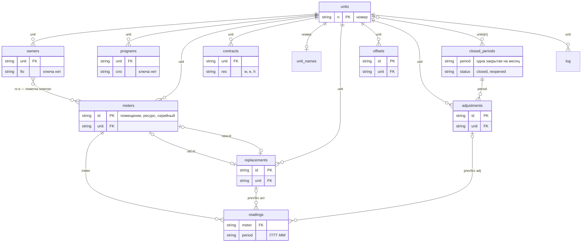

# Схема данных стенда КУ

Документ для разработчика, который переносит базу стенда расчёта коммунальных услуг апарт-отеля TOR'RE Astana в PostgreSQL
через Prisma. Описаны таблицы стенда, их поля, связи и правила целостности, которые соблюдает сервер; предложены схема Prisma
и порядок переноса. Состояние — на 06.10.2026.

Источники: `server/db.js` (список таблиц `TABLES`, сборка помещения `buildUnit`, разбор помещения `putUnit`, `getState`),
`server/periods.js` (закрытые месяцы, корректировки, зачёты и возвраты), `server/import.js` (импорт показаний),
`server/clean.js` (очистка данных месяцев), `server/index.js` (запросы и проверки на входе), `public/index.html`
(`currentSettings`, форма корректировки), `engine/calc.js` (движок, JSDoc-типы в начале файла, `buildSnapshot`). Правила
расчёта — `docs/ПРАВИЛА РАСЧЁТА.md`; запросы сервера и документ выгрузки для кабинета (схема 1.6) — `docs/API.md`; очистка
месяцев — `docs/ОЧИСТКА ДАННЫХ.md`. Если текст расходится с кодом, прав код.

Данные сверены с двумя наборами:

- **тестовый набор** `tests/fixtures/2026-06/` — полная копия базы до очистки: справочники, показания апреля–сентября 2026,
  вводные месяцев;
- **рабочая база** `data/` после очистки месяцев 06.10.2026 — только справочники.

Таблицы, пустые в обоих наборах (закрытые месяцы, корректировки, зачёты, акты замены, протоколы импорта), описаны по коду и
сверены с проверочными копиями базы, на которых выполнялись закрытие месяца, корректировки, зачёт и возврат переплаты, акт
замены и импорт.

**Содержание**

1. [Обзор](#1-обзор) — хранение, таблицы, связи, помещение в запросах
2. [Таблицы](#2-таблицы) — назначение, ключ, поля
3. [Инварианты и правила целостности](#3-инварианты-и-правила-целостности)
4. [Предлагаемая схема Prisma](#4-предлагаемая-схема-prisma) — модели, ключи, перенос
5. [Числа](#5-числа) — записи по таблицам

**Обозначения в таблицах полей**

- «Обяз.»: **да** — ключ есть в каждой записи; **да / null** — ключ есть всегда, значение может быть `null`; **нет** — ключ
  появляется только вместе со значением.
- «Пишет»: **форма** — интерфейс стенда через `PUT /api/unit/:n` (сервер разбирает помещение функцией `putUnit`);
  **таблица** — интерфейс через `PUT /api/table/<имя>` (таблица целиком); **акт** — `POST /api/unit/:n/replace`;
  **импорт** — `POST /api/import`; **сервер** — сервер сам (перенос начала месяца, перенос пометок при запуске, закрытие,
  корректировка, зачёт, очистка). Служебные скрипты стенда пишут через те же запросы.
- Дата — строка «ГГГГ-ММ-ДД»; месяц — «ГГГГ-ММ»; отметка времени — ISO по UTC («2026-10-06T12:30:05.540Z»); пометка на
  удаление — местное время без пояса «ГГГГ-ММ-ДДTчч:мм».

---

## 1. Обзор

### 1.1 Как хранится база

- Таблица — файл `<папка базы>/<имя>.json`. Папка — `data/` рядом с сервером или папка из переменной окружения `TORRE_DATA`.
- Список таблиц — `TABLES` в `server/db.js`: `units`, `owners`, `meters`, `readings`, `contracts`, `tariffs`, `external`,
  `settings`, `log`, `unit_names`, `closed_periods`, `adjustments`, `replacements`, `imports`, `programs`, `offsets`. Вне
  списка — `log_archive.json` (архив журнала) и папка `files/` (файлы вложений договоров).
- `settings` и `unit_names` — объекты, остальные таблицы — массивы записей. Нет файла — таблица пустая (`{}` или `[]`):
  файлы закрытых месяцев, корректировок, зачётов, актов замены и протоколов импорта появляются с первой записью.
- Сервер держит таблицы в памяти и пишет таблицу целиком: во временный файл, сброс на диск, переименование поверх
  (`writeAtomic`). Транзакций между таблицами нет: запись помещения по очереди перезаписывает `programs`, `units`, `owners`,
  `meters`, `readings`, `contracts`; все проверки выполняются до первой записи.
- Копии базы — папки `data/backup/<время>_<пометка>/` со всеми таблицами из `TABLES` (хранятся 30 последних, исходная копия
  от 09.09.2026 — всегда). «Вернуть копию» не меняет `closed_periods`, `adjustments`, `log` и отметки «Просмотрено» в
  `settings`; `log_archive.json` в копии не входит.

### 1.2 Таблицы

| Таблица | Что хранит | Ключ записи в стенде | Пишет |
|---|---|---|---|
| `units` | помещения | `n` — номер | форма |
| `owners` | собственники (линии владения), контакты, ручные пометки разграничения | своего нет: запись внутри помещения | форма; сервер (перенос пометок, акт замены) |
| `programs` | договоры управления | своего нет: запись внутри помещения | форма |
| `meters` | приборы учёта | `id` = «помещение\|ресурс\|серийный номер[#k]» | форма, акт |
| `readings` | показания приборов по месяцам | `meter` + `period` | форма, акт, импорт, сервер |
| `contracts` | договоры разграничения, акты опломбировки, вложения | своего нет: запись внутри помещения и ресурса | форма |
| `replacements` | акты замены приборов | `id` строкой | акт |
| `tariffs` | тарифы | своего нет (журнал различает строки по `svc` + `from`) | таблица |
| `external` | доходные контрагенты — образец для нового месяца | своего нет (позиция в списке) | таблица |
| `settings` | переключатели расчёта, вводные месяцев, Гкал импорта, пользователи, отметки «проверено» и «просмотрено» | один объект | таблица (слиянием), импорт, очистка |
| `unit_names` | подписи под номером помещения | номер помещения — ключ объекта | таблица |
| `closed_periods` | снимки закрытых месяцев | `period` + `status: 'closed'` | сервер (закрытие, переоткрытие) |
| `adjustments` | корректировки закрытых месяцев | `id` строкой | сервер (корректировка), очистка |
| `offsets` | зачёты переплаты и возвраты деньгами | `id` строкой | сервер (зачёт, возврат) |
| `imports` | протоколы импорта показаний | своего нет | импорт |
| `log`, `log_archive` | журнал изменений | своего нет (позиция) | сервер при каждой правке |
| `files/` | файлы вложений | имя файла | `POST /api/files` |

### 1.3 Связи

Ссылки в стенде — по естественным ключам, без проверки ссылочной целостности на уровне хранения.

| Откуда | Поле | Куда | Примечание |
|---|---|---|---|
| `owners`, `programs`, `meters`, `contracts`, `replacements`, `offsets`, `adjustments` | `unit` | `units.n` | |
| `readings` | `meter` | `meters.id` | код прибора начинается с номера помещения; сервер находит показания помещения по префиксу «номер\|» |
| `owners` | ключи `rz.e` | `meters.id` | ручная пометка электросчётчика |
| `replacements` | `old.id`, `new.id` | `meters.id` | снятый и поставленный прибор |
| `readings` | `prevSrc` = `act:<id>` | `replacements.id` | начало нового счётчика в месяце после акта |
| `readings` | `prevSrc` = `adj:<id>[/manual]` | `adjustments.id` | начало, поставленное каскадом корректировки |
| `contracts` | `owner` | `owners.fio` того же помещения | ФИО текстом, сравнение без учёта пробелов и регистра; не ссылка |
| `offsets`, переплаты в снимках и корректировках | `unit` + `fio` | `owners` | собственник определяется по ФИО |
| `closed_periods` | ключи `units` | `units.n` | помещения снимка |
| `closed_periods` | `units[n].det[].m.id` | `meters.id` | прибор, посчитанный в снимке |
| `closed_periods` | `inputs.external[].carryOf` | `adjustments.id` | перенос корректировки в ОДН этого месяца |
| `adjustments` | `period` + `unit` | закрытая запись `closed_periods` и её `units[unit]` | `before` первой корректировки = `units[unit]` снимка, следующей — `after` предыдущей |
| `adjustments` | `carry.period` | месяц | первый открытый месяц после последнего закрытого |
| `settings.byPeriod`, `settings.heatByPeriod`, `readings.period`, `offsets.period`, `imports.period`, `closed_periods.period` | ключ или поле | месяц «ГГГГ-ММ» | отдельной таблицы месяцев нет |
| `settings.audit` | ключ | договор разграничения или управления | `помещение\|ресурс\|№\|с` или `помещение\|программа\|№\|с` |
| `settings.regSeenRows` | ключ | строка `log` | хеш полей строки (раздел 2.10) |
| `contracts.files[].id` | | файл `files/<id>` | |
| `log` | `unit` | `units.n` или `*` | `*` — весь дом; номер может принадлежать удалённому помещению |
| `unit_names` | ключ | `units.n` | |



### 1.4 Помещение в запросах (собранный вид)

Интерфейс и движок работают не с таблицами, а с собранным помещением. Сборка — `buildUnit(u, period)`, разбор обратно —
`putUnit(n, row, period)`; в кабинете это место запросов Prisma с `include`. `GET /api/unit/:n?period=` и `rows` ответа
`GET /api/state?period=` возвращают помещение так:

| Поле | Откуда | Что |
|---|---|---|
| `n`, `fl`, `t`, `area`, `inodn`, `del` | `units` | как в таблице; `inodn` — `false` только при `units.inodn === false`, иначе `true` |
| `prog`, `cno`, `cdt` | `programs` | договор управления, действующий в месяце: из непомеченных и пересекающих месяц — начавшийся позже; нет — `none` |
| `progs` | `programs` | все договоры помещения `{prog, cno, cdt, from, to, del?}`, по дате «с» |
| `fio` | `owners` | ФИО последнего непомеченного собственника в порядке записей таблицы |
| `owners` | `owners` | `{fio, from, to, del?, rz?, phones[], emails[], reps[]}` в порядке записей |
| `meters` | `meters` + `readings` | прибор `{id, res, sn, k, bill, transit, note, from, to, del}`, показания выбранного месяца `prev`, `cur`, `midRead`, `ownRead`, `lockPrev`, `lockCur`, `prevSrc`, `prevNote` и `hist` — те же восемь полей по каждому месяцу, где у прибора есть запись |
| `rz` | `contracts` | `{w: [...], e: [...], h: [...]}`: договоры ресурса `{no, from, to, seal, sealNo, owner, autoClosed, checked, fact, byDays, del, note, files[], actDel}` |
| `_rev` | вычисляется | отпечаток помещения (раздел 3.3) |

`GET /api/state?period=` возвращает также `settings`, `period` (месяц, за который собраны `prev` / `cur`), `tariffs`,
`external`, `unitNames`, `periods` (месяцы, у которых есть показания), `caps` (что умеет сервер) и данные о периоде:
`closed` (снимок, если месяц закрыт), `closedPeriods`, `lastClosed`, `adjustments` (корректировки месяца), `carries`
(корректировки с переносом в ОДН этого месяца), `credits` (все начисленные переплаты), `offsets` (все зачёты и возвраты).
Ровно этот ответ — вход движка `calcMonth(state, period)` (`engine/calc.js`, `engine/README.md`).

---

## 2. Таблицы

### 2.1 `units` — помещения

Помещения дома. Ключ — `n`, номер не меняется (заказчик, 02.10.2026). Создаёт помещение первая запись `PUT /api/unit/:n`
с новым номером.

| Поле | Тип и значения | Обяз. | Смысл и особенности | Пишет |
|---|---|---|---|---|
| `n` | строка: «1001», «НП14», «2.003» | да | номер помещения «как на двери»; смена номера — отказ 409 | форма |
| `fl` | целое | да | этаж; у помещения, заведённого в стенде, ключа нет до первой правки этажа | форма |
| `t` | строка | да | тип, свободный текст; в данных четыре значения: «Апартамент жилой», «Нежилое, этажи 3–4», «Коммерческое», «Нежилое, офис»; справочника типов нет | форма |
| `area` | число, м² | да | площадь: база ЭК, ОДН электроэнергии и тепла, отопления | форма |
| `inodn` | логическое | да | участвует в ОДН. В данных 444 записи хранят `1` (прежний формат), одна — `true`; сервер пишет `true` / `false`, только когда значение меняется (у помещения, заведённого в стенде, ключа может не быть — участвует). Сборка считает «не участвует» только при `false` | форма |
| `prog` | `none` / `trust` / `hybrid` / `share` | да | кэш программы последнего непомеченного договора управления (по дате «с»); пишет `putUnit`. Сборка помещения и расчёт поле не читают — договор месяца берётся из `programs`; поле читают служебные сверки | сервер |
| `cno`, `cdt` | строки; `''` — нет | да | кэш номера и даты того же договора | сервер |
| `del` | местное время | нет | пометка на удаление: в пульте и расчёте помещения нет. Помещение из снимка закрытого месяца пометить нельзя (409) | форма |
| `rzH` | `true` / `false` | нет | прежняя ручная пометка разграничения по теплу. С 06.10.2026 переносится к собственнику (`owners.rz.h`) при запуске сервера и при записи помещения; в данных нет | — |

### 2.2 `owners` — собственники

Линии владения помещением, контакты собственника и представителей, ручные пометки разграничения (с 06.10.2026).

**Ключ.** Своего нет: запись принадлежит помещению (`unit`). При записи помещения собственники этого помещения
пересобираются целиком; прежние записи сопоставляются с присланными функцией `matchRecs` по полям `fio`, `from`, `to`
(сначала по всем трём, потом по одному полю в этом порядке, оставшиеся — по порядку). По сопоставлению сервер переносит поля,
которых интерфейс не прислал, и пишет журнал. Порядок записей — как прислал интерфейс; от порядка зависят `fio` собранного
помещения и выбор собственника при одинаковых датах.

| Поле | Тип и значения | Обяз. | Смысл и особенности | Пишет |
|---|---|---|---|---|
| `unit` | строка | да | номер помещения | форма |
| `fio` | строка | да | ФИО или наименование; у нового помещения пустое. Расчёт и учёт переплаты сравнивают ФИО без учёта лишних пробелов и регистра (в данных 5 ФИО с лишними пробелами) | форма |
| `from` | дата или `null` | да / null | владеет с; `null` — с начала учёта | форма |
| `to` | дата или `null` | да / null | владеет по; `null` — по сей день | форма |
| `del` | местное время | нет | пометка на удаление | форма |
| `phones` | массив строк | нет | телефоны; пробелы по краям убираются, пустые не пишутся | форма (реестр) |
| `emails` | массив строк | нет | e-mail | форма (реестр) |
| `reps` | массив `{fio, phones[], emails[], basis, note}` | нет | представители: ФИО, телефоны, e-mail, основание (доверенность, срок), примечание (интерфейс его не заполняет, сервер сохраняет). Представитель без ФИО, телефонов и e-mail не пишется | форма (реестр) |
| `rz` | объект `{w?, h?, e?}` | нет | ручные пометки разграничения собственника: `w` — все водяные приборы помещения, `h` — тепло, `e` — `{код прибора: true / false}` по электросчётчикам. `true` — «разграничено вручную», `false` — «в счёт УК вручную», ключа нет — «по договору разграничения». Пометка действует в дни владения своего собственника, продажа её не передаёт. Хранятся только `true` / `false`; пустой объект не пишется | форма; сервер (перенос пометок старого вида); акт (пометка электро копируется на новый счётчик) |

Особенности:

- Интерфейс не прислал `phones`, `emails`, `reps`, `rz` — берутся из сопоставленной прежней записи.
- Код прибора сменился (исправлен серийный номер у прибора без показаний) — ключ в `rz.e` переименовывается. Ключ
  удалённого прибора не удаляется.
- Пометки старого вида (`meters.rz`, `units.rzH`) относятся к последнему по дате «с» непомеченному собственнику: перенос —
  при запуске сервера (`migrateMarks`, с копией базы `pre-start-marks`) и при записи помещения.
- Смена собственника — не больше одной в календарном месяце (раздел 3.1).

### 2.3 `programs` — договоры управления

Датированная линия договоров управления помещения: программа определяет, кто платит КУ и ЭК.

**Ключ.** Своего нет: запись помещения; сопоставление при записи — `matchRecs` по `cno`, `from`, `prog`, `cdt`, `to`.

| Поле | Тип и значения | Обяз. | Смысл и особенности | Пишет |
|---|---|---|---|---|
| `unit` | строка | да | номер помещения | форма |
| `prog` | `none` / `trust` / `hybrid` / `share` | да | программа: не в управлении, доверительная, гибридная, долевая; другое значение — 400. В данных только `trust`, `hybrid`, `share` | форма |
| `cno` | строка | да | номер договора, например «№15/5002/Т»; буква в номере правилом не является | форма |
| `cdt` | дата или `null` | да / null | дата договора | форма |
| `from` | дата или `null` | да / null | в управлении с; в данных совпадает с `cdt` | форма |
| `to` | дата или `null` | да / null | в управлении по; при продаже интерфейс ставит день до передачи | форма |
| `del` | местное время | нет | пометка на удаление: договор не действует | форма |

Помещение без договоров — «не в управлении». Между договорами — тоже не в управлении.

### 2.4 `meters` — приборы учёта

**Ключ** — `id`, код прибора: `<помещение>|<ресурс>|<серийный номер или noSN>`. Если код занят, при записи помещения
добавляется `#2`, `#3`…; при акте замены, если код нового счётчика уже есть, — `#<время в миллисекундах>`. Код постоянен,
пока у прибора тот же ресурс и серийный номер; прибор без показаний с исправленным серийным номером получает новый
свободный код. Код используют показания, пометки собственников, акты, снимки и корректировки.

| Поле | Тип и значения | Обяз. | Смысл и особенности | Пишет |
|---|---|---|---|---|
| `id` | строка | да | код прибора | форма, акт |
| `unit` | строка | да | номер помещения | форма, акт |
| `res` | `hvs` / `gvs` / `ee` | да | холодная вода, горячая вода, электроэнергия; другое значение — 400. У прибора с показаниями не меняется (409) | форма, акт |
| `sn` | строка | да | серийный номер, может быть пустым. У прибора с показаниями не меняется (409): новый счётчик ставит акт замены | форма, акт |
| `k` | число | да | коэффициент трансформации; не прислан — 1. В данных 1 у 1 390 приборов, у 10 — от 15 до 80. Сервер значение не проверяет; расчёт `0` считает как 1 | форма, акт |
| `bill` | логическое | да | участвует в расчётах; `false` — прибор не начисляется безусловно | форма |
| `transit` | логическое | да | прежняя метка «транзит»: с 18.09.2026 в расчёте не участвует, везде `false` | форма |
| `note` | строка | да | примечание. Акт дописывает снятому «снят <дата>, замена на <серийный>», новому пишет «установлен <дата> взамен <серийный>» | форма, акт |
| `from` | дата или `null` | да / null | установлен; у поставленного актом — дата акта (не меняется, 409). Прибор, установленный после конца месяца, в месяце не участвует | форма, акт |
| `to` | дата или `null` | да / null | снят; у снятого актом — дата акта (не меняется, 409). Прибор, снятый до начала месяца, в месяце не участвует | форма, акт |
| `del` | местное время | нет | пометка на удаление: в расчёте прибора нет, показания хранятся | форма |
| `rz` | `true` / `false` | нет | прежняя ручная пометка; с 06.10.2026 — у собственника (`owners.rz`). В данных нет | — |

Особенности:

- Интерфейс не прислал `from` / `to` — берутся прежние.
- Удаление прибора удаляет все его показания.
- Нельзя: удалить окончательно прибор, посчитанный в снимке закрытого месяца; удалить или пометить на удаление прибор из акта
  замены (раздел 3.1).

### 2.5 `readings` — показания

**Ключ** — `meter` + `period`: одна запись на прибор и месяц. Запись без единого показания не создаётся, если её не было.

| Поле | Тип и значения | Обяз. | Смысл и особенности | Пишет |
|---|---|---|---|---|
| `meter` | строка | да | код прибора | форма, акт, импорт, сервер |
| `period` | месяц | да | месяц показаний | форма, акт, импорт, сервер |
| `prev` | число или `null` | да / null | начальное показание. Правило: начало месяца = конец прошлого месяца в стенде (раздел 3.5) | форма, импорт, акт, сервер |
| `cur` | число или `null` | да / null | конечное показание | форма, импорт, акт |
| `midRead` | число или `null` | да / null | показание на дату договора разграничения. Вводится в форме; расчёт с 22.09.2026 его не использует (договор разграничивает месяц целиком, правило 38); значение вне `prev`…`cur` — пункт чек-листа закрытия | форма |
| `ownRead` | число или `null` | да / null | показание на дату передачи помещения новому собственнику: расчёт делит им объём месяца, если оно между `prev` и `cur` | форма |
| `lockPrev` | `true` | нет | начальное зафиксировано актом замены (новый счётчик) | акт |
| `lockCur` | `true` | нет | конечное зафиксировано актом замены (снятый счётчик) | акт |
| `prevSrc` | строка | нет | откуда начальное: `manual` — внесено руками; `carry` — перенесено из конца прошлого месяца; `act:<id акта>` — новый счётчик в месяце после акта, начало = конечное за месяц замены; `adj:<id корректировки>` или `adj:<id>/manual` — каскад корректировки закрытого месяца (автоматически или введено вручную в форме корректировки) | форма (`manual`), сервер, корректировка |
| `prevNote` | строка | нет | подпись к началу: «конечное за месяц замены (ГГГГ-ММ) — новый счётчик», «из корректировки за ГГГГ-ММ», «нет данных — показание удалено корректировкой». В наборе у 12 записей значение `null` (записаны до 04.10.2026) | сервер |

Особенности:

- Показание — число; строка «297,388» (запятая, пробелы) приводится к числу, не число — 400.
- Замки ставит только акт. Интерфейс их не присылает и не снимает; сервер переносит из прежней записи. Значение с замком не
  меняет ни форма (409), ни импорт, ни перенос начала.
- `prevSrc`: интерфейс присылает `manual` при ручной правке начального; не прислал — сохраняется прежний.
- Месяц, которого интерфейс не прислал (страница открыта до импорта), при записи помещения сохраняется. `midRead` и
  `ownRead` других месяцев, не присланные интерфейсом, тоже сохраняются.

### 2.6 `contracts` — договоры разграничения

Прямые договоры собственника с поставщиком (вода, электроэнергия, тепло), акты опломбировки, вложения.

**Ключ.** Своего нет: запись помещения и ресурса; сопоставление при записи — `matchRecs` по `no`, `from`, `seal`, `to` в
пределах ресурса. Номер договора не уникален: 71 номер встречается у нескольких помещений (вода — 36, тепло — 33, электро —
2; всего 289 договоров).

| Поле | Тип и значения | Обяз. | Смысл и особенности | Пишет |
|---|---|---|---|---|
| `unit` | строка | да | номер помещения | форма |
| `res` | `w` / `e` / `h` | да | вода, электроэнергия, тепло. Сервер значение не проверяет | форма |
| `no` | строка | да | номер договора; может быть пустым (договор «по факту») | форма |
| `from` | дата или `null` | да / null | дата договора. По воде разграничение действует с даты акта `seal`; по теплу достаточно номера, дату вносят позже | форма |
| `to` | дата или `null` | да / null | по; при продаже интерфейс ставит день до передачи | форма |
| `seal` | дата или `null` | да / null | дата акта опломбировки (только вода); без акта договор по воде не действует | форма |
| `sealNo` | строка | да | номер акта опломбировки | форма |
| `byDays` | логическое | да | «без показания на дату начала — делить по дням». С 22.09.2026 (договор разграничивает месяц целиком) на расчёт не влияет; везде `false` | форма |
| `owner` | строка | да | «чей договор» — ФИО собственника текстом. Расчёт: договор, записанный на собственника, не закрывается при переходе помещения к нему; договор без записи принадлежит тому, кто владел в день договора. Не ссылка: из 9 заполненных у 2 текст не совпадает ни с одним ФИО помещения | форма |
| `autoClosed` | дата или `null` | да / null | дата смены собственника, которой интерфейс закрыл договор автоматически | форма |
| `checked` | логическое | да | дата закрытия проверена оператором (поставщик закрыл договор своим числом): при заполненном `to` продажа такой договор не обрезает | форма |
| `fact` | логическое | да | «по факту»: договор действует без номера и даты — решение оператора | форма |
| `del` | местное время | нет | пометка договора на удаление | форма |
| `note` | строка до 4 000 знаков | нет | описание договора | форма |
| `files` | массив | нет | вложения `{id, name, type, size, at, by, part, del?}`: `id` — имя файла в `files/` (`[\w.-]{1,80}`), `name` — имя для оператора (до 200 знаков), `type` — MIME, `size` — байт, `at` — местное время загрузки, `by` — кто, `part` — `dog` (договор) или `act` (акт), `del` — пометка на удаление | форма |
| `actDel` | `{seal, sealNo, del}` | нет | акт опломбировки, помеченный на удаление: дата и номер акта перенесены сюда, `seal` договора пуст — расчёт видит договор без акта; снятие пометки возвращает их | форма |

Особенности:

- `note`, `files`, `actDel` не прислал интерфейс — берутся из сопоставленной прежней записи.
- Удаление договора файлы не удаляет. Файл убирается в `files/_deleted/` отдельным запросом, только если его нет во вложениях
  ни одного договора.

### 2.7 `replacements` — акты замены приборов

Акт снимает старый прибор и ставит новый одной датой; показания акта фиксируются замками. **Ключ** — `id`.

| Поле | Тип и значения | Обяз. | Смысл |
|---|---|---|---|
| `id` | строка | да | «помещение\|ресурс\|дата\|старый серийный→новый серийный» |
| `unit` | строка | да | номер помещения |
| `res` | `hvs` / `gvs` / `ee` | да | ресурс обоих приборов |
| `date` | дата | да | дата замены: у старого — `to`, у нового — `from` |
| `period` | месяц | да | месяц замены |
| `old` | `{id, sn, final}` | да | снятый прибор: код, серийный номер, конечное показание (в `readings` месяца замены — `cur` с `lockCur`) |
| `new` | `{id, sn, k, initial}` | да | поставленный прибор: код, серийный номер, коэффициент, начальное показание (`prev` с `lockPrev`) |
| `note` | строка | да | примечание оператора |
| `at` | отметка времени | да | когда оформлен |

Пишет только акт (`POST /api/unit/:n/replace`). Удаление помещения удаляет его акты. Правила — раздел 3.4.

### 2.8 `tariffs` — тарифы

| Поле | Тип и значения | Обяз. | Смысл и особенности |
|---|---|---|---|
| `svc` | `water_supply` / `water_drainage` / `electricity` / `heating` / `maintenance` / `capital_repair` | да | услуга: водоснабжение, водоотведение, электроэнергия, теплоэнергия, техобслуживание МОП, взносы на капремонт |
| `lab` | строка | да | подпись услуги для интерфейса; расчёт не читает |
| `base` | число | да | тариф без НДС; строку («467,62») сервер приводит к числу |
| `vat` | число | да | НДС, %: 16 у коммунальных услуг, 0 у ЭК |
| `from` | дата | да | действует с |
| `to` | дата или `''` | да | по; `''` — бессрочно |

Пишет таблица (`PUT /api/table/tariffs`) целиком; журнал — строкой на изменённую строку тарифа (строка различается по `svc` +
`from`). Пересечения строк, тариф 0, строку без «с» сервер принимает — проверяют шапка месяца и чек-лист закрытия. Закрытый
месяц считается по строкам тарифов из снимка (`inputs.tariffRows`).

### 2.9 `external` — доходные контрагенты (образец)

Список контрагентов, объём которых вычитается из счёта-фактуры при расчёте ОДН. Таблица — образец для нового месяца; доходные
конкретного месяца хранятся в `settings.byPeriod[месяц].ext`.

| Поле | Тип и значения | Обяз. | Смысл и особенности |
|---|---|---|---|
| `n` | строка | да | название контрагента |
| `res` | `water` / `electricity` / `heat` | да | ресурс; строку по теплу расчёт не вычитает (открытый вопрос, `docs/ОТКРЫТЫЕ ВОПРОСЫ.md`) |
| `c` | число | да | объём за месяц |
| `on` | `0` / `1` | да | «Учит.» — вычитается |
| `defOff` | `1` | нет | «по умолчанию не учитывается»: в новом месяце строка начинается с `on: 0`. Из интерфейса не ставится, переносится при каждой пересборке строки |

Пишет таблица (`PUT /api/table/external`). Признак `need` («объём за месяц не введён») здесь не хранится — только в списке
месяца.

### 2.10 `settings` — настройки

Один объект. Пишет таблица: `PUT /api/table/settings` со слиянием (раздел 3.6). Импорт ЭСФ дописывает тепло в
`byPeriod` и `heatByPeriod`; очистка месяцев удаляет записи месяцев.

| Поле | Тип и значения | Смысл и особенности |
|---|---|---|
| `period` | месяц | месяц, выбранный последним в интерфейсе. Сервер берёт его по умолчанию для запросов без `?period=` и для поля `period` журнала; общий для всех пользователей |
| `applyRz` | логическое | «применять договоры разграничения»: `false` — договоры не действуют во всех незакрытых месяцах |
| `ukPays` | логическое | «компания платит КУ за помещения в управлении» |
| `sealFrom` | логическое | устаревший переключатель «вода — с даты акта опломбировки»: убран 03.10.2026, расчёт его не читает, в снимок пишется `true` |
| `byPeriod` | `{месяц: запись}` | вводные месяца (таблица ниже) |
| `heatByPeriod` | `{месяц: число}` | Гкал месяца из импорта ЭСФ |
| `users` | массив `{name, dept}` | кто работает: «Бухгалтерия» (`k`), «Работа с собственниками» (`r`), «Руководитель» (`''`). Паролей нет: имя приходит заголовком `X-User`. Нет списка — эти три по умолчанию. Открыть месяц заново и очистить месяцы может только пользователь из списка с отделом не `r` |
| `audit` | `{rz: {ключ: {at, fp}}, prog: {ключ: {at, fp}}}` | отметки «проверено» по договорам. Ключ: `помещение\|ресурс\|№\|с` (разграничение) или `помещение\|программа\|№\|с` (управление). `at` — дата проверки; `fp` — отпечаток реквизитов на момент проверки (JSON-массив: у разграничения — `no`, `from`, `to`, `seal`, `sealNo`, `owner`, `fact`; у управления — `prog`, `cno`, `cdt`, `from`, `to`). Реквизиты изменились — отметка «устарела» |
| `regSeen` | `{at, by}` | общая отметка бухгалтерии «Просмотрено» правок реестра |
| `regSeenRows` | `{ключ строки журнала: {at, by}}` | отметки «просмотрено» по строке журнала. Ключ: первые 19 знаков `at` строки, «.», хеш FNV-1a (32 бита, запись по основанию 36) от `at`, `unit`, `what`, `before`, `after`, `by`, соединённых символом U+0001 |
| `inW`, `inE`, `ukW`, `ukE`, `ukH`, `ek`, `bldArea`, `heatGcal`, `inWAmt`, `inEAmt`, `heatAmt`, `heat1`, `heat2`, `heat2Amt`, `inW2`, `inW2Amt`, `inE2`, `inE2Amt` | строки | поля шапки выбранного месяца, повторённые страницей в общих настройках. Источник вводных — `byPeriod`. `heatGcal` расчёт берёт как запасное значение тепла только для записи месяца без поля `heat1` (записи, заведённые до позиций счёта-фактуры). Очистка удаляет эти поля вместе с выбранным месяцем |

**Запись месяца `byPeriod[месяц]`**

| Поле | Значения | Смысл |
|---|---|---|
| `inW`, `inE` | число текстом | объём по счёту-фактуре: вода, м³; электроэнергия, кВт·ч |
| `inW2`, `inE2` | число текстом | вторая позиция счёта-фактуры (тариф менялся внутри месяца) |
| `heat1`, `heat2` | число текстом | тепло по ЭСФ, Гкал: первая и вторая позиции |
| `inWAmt`, `inW2Amt`, `inEAmt`, `inE2Amt`, `heatAmt`, `heat2Amt` | число текстом | суммы позиций, ₸ (сумма и объём пересчитываются друг из друга только из ввода оператора) |
| `ukW`, `ukE`, `ukH` | число текстом | нужды ЭК: вода, электроэнергия, тепло (Гкал) |
| `ek` | число текстом | «ЭК берёт из ОДН», ₸; в новом месяце `'0'` |
| `bldArea` | число текстом | общая площадь здания, м²; пусто — 23 474,3 |
| `src` | `manual` / `copied` / `empty` | состояние вводных: введены оператором; скопированы (месяцы, заведённые до 05.10.2026); новый месяц, не заполнен |
| `ext` | массив `{n, res, c, on, need?, defOff?}` | доходные месяца; `need: 1` — объём за месяц не введён |
| `extSrc` | `manual` / `copied` / `empty` | состояние доходных месяца |

Числа хранятся текстом так, как их ввели: «3 299 963,73», «0,2121». Пустая строка — поле пусто («нужно заполнить», расчёт
берёт 0); отсутствие поля — поля в записи нет. Это разные состояния:

- запись без `inW` и `inE` завёл импорт ЭСФ (в ней только тепло) — страница достраивает её как новый месяц;
- запись без `heat1` (заведена до позиций счёта-фактуры) — тепло берётся из `heatByPeriod`, иначе из общего `heatGcal`, за
  вычетом второй позиции; при `heat1: ''` запасной путь не срабатывает.

Новый месяц страница заводит так: `{inW: '', inE: '', ukW: '', ukE: '', ukH: '', ek: '0', inWAmt: '', inEAmt: '',
heatAmt: '', heat1: <Гкал импорта ЭСФ или ''>, src: 'empty'}` и доходные — те же контрагенты с объёмом 0 и `need: 1`
(`extSrc: 'empty'`); запись уходит на сервер со следующим сохранением настроек. Журнал (помещение `*` — весь дом): правки
полей месяца — строкой «вводные месяца · …», доходных месяца — «вводные месяца · доходные», переключателей — «переключатель
«…»»; служебное (`period`, `audit`, `regSeen`, `regSeenRows`, `users`) не пишется.

### 2.11 `unit_names` — подписи помещений

Объект `{номер помещения: подпись}`. Подпись — вывеска арендатора или фамилия собственника (фамилии интерфейс под номером не
показывает). Интерфейс таблицу не правит; сервер принимает её целиком (`PUT /api/table/unit_names`).

### 2.12 `closed_periods` — снимки закрытых месяцев

Закрытый месяц показывается из снимка; данные помещений после закрытия меняются только корректировками. Снимок собирает
страница движком (`buildSnapshot`), сервер проверяет тождества и хранит его как прислано. Снимок не правится никогда.

**Ключ.** Закрытие создаёт новую запись. Переоткрытие не удаляет её: `status` становится `reopened`, в `history`
добавляется строка. Повторное закрытие того же месяца — новая запись. Поэтому записей на месяц может быть несколько, из них
не больше одной со `status: 'closed'`; действующий снимок месяца — запись `period` + `status: 'closed'`.

| Поле | Тип | Смысл |
|---|---|---|
| `period` | месяц | закрытый месяц |
| `status` | `closed` / `reopened` | действует / открыт заново |
| `closedAt` | отметка времени | когда закрыт |
| `closedBy` | строка | кто закрыл (роль из `X-User`) |
| `forced` | логическое | закрыт принудительно — при непройденных пунктах чек-листа |
| `note` | строка | причина принудительного закрытия (обязательна при `forced`) |
| `checklist` | объект | чек-лист закрытия на момент закрытия |
| `engineVersion` | строка | версия правил расчёта (`ENGINE_VERSION`) |
| `inputs` | объект | вводные месяца, на которых считали |
| `ctx` | объект | контекст расчёта: база и коэффициенты ОДН, тепло дома |
| `totals` | объект | итоги месяца |
| `units` | `{номер: результат}` | расчёт каждого помещения |
| `credits` | массив | переплаты, начисленные на закрытии |
| `history` | массив | закрытия и переоткрытия этой записи |

**`inputs`**

| Поле | Смысл |
|---|---|
| `inW`, `inE`, `heatGcal` | объёмы по счетам-фактурам (сумма позиций): вода, электроэнергия, тепло — числа |
| `inWAmt`, `inEAmt`, `heatAmt` | суммы счетов-фактур, ₸; не введены — `null` |
| `sfPositions` | позиции счетов-фактур: `{w: [{from, to, vol}], e: [...], h: [...], amt: {w: [сумма 1, сумма 2], e: [...], h: [...]}}` |
| `ukW`, `ukE`, `ukH` | нужды ЭК: вода, электроэнергия, тепло |
| `ek` | «ЭК берёт из ОДН», ₸ |
| `bldArea` | общая площадь здания, взятая расчётом |
| `applyRz`, `ukPays`, `sealFrom` | переключатели расчёта (`sealFrom` всегда `true`) |
| `external` | доходные месяца `[{n, res, c, on, defOff?}]`; при закрытии сервер дописывает строки переносов корректировок прошлых месяцев `{n: подпись, res, c, on: 1, carryOf: id корректировки}` |
| `tariffs` | тарифы месяца с НДС: `ws`, `wd`, `el`, `heat`, `maint`, `maintBase`, `capRepair` |
| `tariffRows` | строки таблицы тарифов, действовавшие в месяце: `[{svc, base, vat, from, to}]` |

**`ctx`** — числа контекста месяца: `t` (тарифы), `sumW`, `sumE` (объём «в счёт УК»), `inW`, `inE`, `ukW`, `ukE`, `odnW`,
`odnE` (ОДН дома), `nOdn`, `areaOdn` (база ОДН: помещений и площадь), `odnPerUnitW`, `odnPerAreaE`, `heatGcal`, `bldArea`,
`areaHeatRz`, `nHeatRz`, `nHeatFree`, `heatBaseArea`, `areaHeatBase`, `heatUsed`, `kOt` (коэффициент отопления), `ukH`,
`heatRest`, `kOdn` (ОДН тепла на м²), `heatBaseBad`, `heatRestNeg`, `extW`, `extE`, `carryW`, `carryE`, `carryH`,
`odnAmtTot`, `ek`, `ekFactor`. Снимки, закрытые до 05.10.2026, не содержат полей тепла по формуле Бухгалтерии и `tariffRows`
— страница показывает их по прежней схеме.

**`totals`** — `accrued` (начислено КУ), `er` (ЭК), `odnAmt` (ОДН, ₸), `byPayer` (`{uk, deduction, owner}`), `units`
(помещений), `invoices` (квитанций), `direct` (`{w, e, h}` — объём у поставщиков напрямую).

**`checklist`** — `{ключ: {label, ok, text, list?, confirmable?, confirmed?}}`; ключи: `readingsW`, `readingsE`, `heat`,
`metersNoReading`, `balance`, `odnComp`, `ext`, `inputs`, `unknown`, `regFeed`, `tariffs`, `tariffZero`, `negatives`,
`midReads`, `overpay`. `confirmed` — пункт подтверждён оператором при закрытии.

**`units[номер]`** — результат расчёта помещения (`calcRow`) как есть, без истории показаний: `n`, `area`, `inodn`, `fio`
(собственник на конец месяца), `prog`, `cno`, `cdt`, `payer` (`owner` / `uk` / `deduction` / `mixed`), `paidByUK`, `det`
(приборы: копия прибора `m` с показаниями месяца, объём, промежутки `iv`), объёмы (`water`, `waterAll`, `eB`, `eRaw`,
`heatVol`, `heat`), ОДН (`odnW`, `odnE`, `odnH`), суммы строк (`aWs`, `aWd`, `aE`, `aH`, `aOdnWs`, `aOdnWd`, `aOdnE`, `aOdnH`,
`odnAmt`, `mop`, `cap`, `total`, `er`, `hand`), признаки (`neg`, `rzW`, `rzE`, `rzH`, `sleeps`), отрезки месяца (`segs`,
`slices`, `ownChg`), квитанции `split.parts[]` — `fio`, `from`, `to`, `days`, `share`, `payer`, `prog`, строки и суммы, `tl`
(строки по тарифам), коды `code` (`КВ-<помещение>-<месяц>[/k]`) и `codeEr` (`ЭК-…`). Если в месяц пришли строки — `recalc`
(«Перерасчёт за …»: `{adj, fio, payer, target, amount, ownFrom?, line, sep?}`) и `offsets` («Зачёт переплаты»:
`{id, fio, payer, target, amount, ownFrom?, line, sep?}`); `sep` — строка отдельной квитанции прежнего собственника.

**`credits`** — `[{unit, fio, period, code, type: KU | EK, amount}]`: квитанции собственника, ушедшие в минус, — его
переплата (целые тенге, больше нуля). Считает страница, сервер нормализует и хранит.

**`history`** — `[{closedAt, closedBy, reopenedAt, reopenedBy, reason}]`.

Объём: снимок месяца ~3,8 МБ (445 помещений, ~8,6 КБ на помещение). В снимке — ФИО собственников, их контакты (в
`units[n].segs[].ownerSeg`) и списки чек-листа с ФИО: доступ к таблице — как к персональным данным.

### 2.13 `adjustments` — корректировки

Корректировка закрытого месяца по одному помещению: снимок не меняется, разница выставляется документами.

**Ключ** — `id` = `ADJ-<месяц>-<помещение>-<seq>`; `seq` — номер корректировки помещения в месяце, с 1. Одно действие
оператора — группа `ADJG-<последний закрытый месяц>-<помещение>-<номер>`: последний закрытый месяц — полная корректировка,
более ранние — суммарные.

| Поле | Тип и значения | Смысл |
|---|---|---|
| `id` | строка | номер корректировки |
| `period` | месяц | закрытый месяц, который корректируется |
| `unit` | строка | помещение |
| `seq` | целое | порядковый номер в месяце по помещению |
| `group` | строка или `null` | группа; `null` — корректировка через прежний одиночный запрос `POST /api/period/:p/adjust/:unit` (интерфейс им не пользуется) |
| `scope` | `full` / `summary` | полная (последний закрытый месяц: каскад, корректировочная квитанция или строка) / суммарная (более ранний месяц: строкой в первом открытом) |
| `at`, `by` | отметка времени, строка | когда и кто оформил |
| `type` | `contract` / `reading` / `reading-delete` / `owner` / `other` / `amount` | тип: договор разграничения, исправление показания, удаление показания, смена собственника, другое, сумма вручную |
| `cause` | объект | причина полями: `contract` — `{res, no, from, seal, sealNo}`; `reading` — `{meter, meterId, period, field, was, now}`; `owner` — `{fio, date, ownRead}`; `amount` — `{target, amount, key, fio, payer}`; `other` — `{}` |
| `text` | строка | пояснение оператора |
| `reason` | строка | причина словами (собрана из `cause` и `text`); пустая — отказ |
| `changes` | массив `{at, what, before, after}` | строки журнала помещения — что правили до оформления |
| `before` | объект | расчёт помещения до: `units[unit]` снимка или `after` предыдущей корректировки |
| `after` | объект | пересчёт помещения в контексте снимка (считает страница) |
| `delta` | объект | разница «после − до» по строкам (`water`, `eB`, `heatVol`, `odnW`, `odnE`, `odnH`, `aWs`, `aWd`, `aE`, `aH`, `odnAmt`, `total`, `er`), по квитанциям `parts[{idx, fio, total}]` и по счетам «собственник + плательщик» `accounts[{fio, payer, ku, ek}]` (к оплате КУ и ЭК, целые тенге) |
| `billing` | `none` / `corrective` / `next-period` / `mixed` | как выставлено: без выставления; корректировочной квитанцией; строкой в квитанции следующего месяца; и так и так |
| `invoices` | массив | документы. Корректировочная квитанция: `{kind: 'corrective', target: KU / EK, code (КВ-…/К1, при частях /1К1), replaces[], part, parts, fio, payer, from, to, days, share, area, mgmt, lines, before, manual[], total, was, now, settle, creditDelta, annul?, adjustment, group}`; строка в следующем месяце: `{kind: 'next-period', target, period, fio, payer, ownFrom, line, amount, adjustment, group}`. Суммы считает страница, сервер хранит |
| `carry` | `{period, water, e, heat, note}` | перенос в ОДН первого открытого месяца: изменение объёма «в счёт УК» и ОДН помещения (м³, кВт·ч, Гкал) |
| `cascade` | массив `{meter, period, field: 'prev', before, after, mode}` | каскад: новое конечное показание закрытого месяца → начальное следующего; `mode` — `auto` / `manual` / `empty` / `locked` |
| `credits` | массив `{unit, fio, period, code, type, amount, adj}` | изменение переплаты собственника по корректировочным квитанциям, со знаком (только у групповых корректировок) |
| `carryCleared` | `{at, by, was: {water, e, heat}}` | перенос обнулён очисткой месяца: когда, кто, прежние объёмы; поле есть только после очистки |
| `status` | `applied` | действует; отмены нет — только следующая корректировка |

Объём: ~20 КБ на корректировку (два полных расчёта помещения).

### 2.14 `offsets` — зачёты и возвраты переплаты

Две записи разного смысла в одной таблице. **Ключ** — `id`.

| Поле | Тип и значения | Зачёт (`KU`, `EK`) | Возврат (`REFUND`) |
|---|---|---|---|
| `id` | строка | `OFF-<месяц>-<помещение>-<k>-<время base36>` | `REF-<помещение>-<k>-<время base36>` |
| `unit` | строка | помещение | помещение |
| `fio` | строка | собственник — как прислали (как в квитанции) | собственник — как в его переплате |
| `ownFrom` | дата или `null` | с какой даты владеет собственник зачёта (`null` — первый собственник); нет поля — запись до 06.10.2026, собственник ищется по ФИО | — |
| `amount` | целое > 0 | сумма зачёта, ₸ | сумма возврата, ₸ |
| `type` | `KU` / `EK` / `REFUND` | квитанция, в которую зачтено: коммунальная или эксплуатационная | возврат деньгами |
| `period` | месяц | открытый месяц квитанции | нет поля (иначе прежняя страница приняла бы возврат за строку квитанции) |
| `date` | дата | — | дата возврата, не позже сегодняшней |
| `month` | месяц | — | месяц даты возврата |
| `note` | строка до 300 знаков | пояснение (в строке квитанции) | как вернули — обязательно, не короче 3 знаков |
| `at`, `by` | отметка времени, строка | когда и кто | когда и кто |

Зачёт — строка «Зачёт переплаты» в квитанции открытого месяца; после закрытия месяца он в снимке (`units[n].offsets`).
Возврат квитанций не меняет. Остаток переплаты собственника по помещению = начислено (`credits` действующих снимков и
корректировок) − зачтено − возвращено.

### 2.15 `imports` — протоколы импорта

Запись на каждый `POST /api/import`.

| Поле | Тип | Смысл |
|---|---|---|
| `period` | месяц | месяц импорта |
| `at` | отметка времени | когда |
| `folder` | строка | папка файлов (абсолютный путь на компьютере стенда, `Импорт/ГГГГ/ММ`) |
| `files` | массив строк | имена файлов в папке |
| `written` | целое | приборов, у которых записано показание |
| `summary` | объект | по ресурсам `hvs`, `gvs`, `ee`: `{meters, prev, cur, locked, manual, adj, starts}`; числа `unmatched`, `missing`, `warnings`, `alerts`, `negative`, `stale` |
| `heat` | число или `null` | Гкал по ЭСФ |
| `unmatched` | массив `{sn, unit, src}` | приборы из файлов, которых нет в стенде (`unit` — подпись из файла) |
| `missing` | целое | приборов стенда без данных в файлах |
| `warnings` | массив строк | предупреждения |

Протокол читает чек-лист закрытия (очередь неизвестных приборов — последний протокол месяца). Очистка удаляет протоколы
очищаемых месяцев.

### 2.16 `log`, `log_archive` — журнал изменений

Строка на каждую правку. Пишет только сервер (`logChange`); при импорте и переносе начала — пачкой, файлом один раз.

| Поле | Тип | Обяз. | Смысл |
|---|---|---|---|
| `at` | отметка времени | да | когда |
| `unit` | строка | да | номер помещения или `*` — весь дом (настройки, тарифы, закрытие, очистка, возврат копии, приведение базы при запуске) |
| `what` | строка | да | что изменено: «владеет с», «текущее показание · ХВС 8488983», «период 2026-06 закрыт», «корректировка ADJ-…» |
| `before`, `after` | строка | да | было и стало — текстом; числа в новых записях — «2 276,14», флаги — словами; старые записи хранят «true», «1» |
| `period` | месяц или `''` | да | месяц правки; не указан — `settings.period`. В данных одна строка без поля (разовая правка данных) |
| `by` | строка | нет | кто: роль из `X-User` или подпись служебного скрипта |
| `kind` | `reg` | нет | правка реестра (собственник, владение, контакты, представители, договоры управления) — по тексту `what`; по ним бухгалтерия видит «новые изменения реестра» |

Журнал длиннее 25 000 строк — самые старые уходят в `log_archive.json` (в журнале остаётся 20 000). Архив — тот же формат,
в копии базы не входит, при «Вернуть копию» не меняется. `GET /api/log` без параметров отдаёт последние 500 строк и число
всех в заголовке `X-Log-Total`.

### 2.17 `files/` — вложения

Файлы сканов и фото договоров и актов: `<папка базы>/files/<id>`; удалённые — `files/_deleted/<id>`. Имя файла —
`ГГГГММДД-ччммсс-<6 шестнадцатеричных знаков><расширение>`, выдаёт `POST /api/files?name=`. Принимаются `.jpg`, `.jpeg`,
`.png`, `.gif`, `.webp`, `.bmp`, `.tif`, `.tiff`, `.heic`, `.heif`, `.pdf`, до 25 МБ, не пустые. Описание файла хранится в
договоре (`contracts.files`). Удаление переносит файл в `_deleted` и отказывает (409), пока файл есть во вложениях договора;
файлы не стираются, чтобы возврат копии базы не остался без сканов. Папка не входит в копии базы и в git.

---

## 3. Инварианты и правила целостности

### 3.1 Запись помещения — проверки до первой записи

`PUT /api/unit/:n?period=` → `putUnit`. Отказ — без единой записи; 400 — ошибка ввода, 409 — нельзя по правилам.

| № | Правило | Что проверяется | Ответ |
|---|---|---|---|
| 1 | Тело — объект помещения | пустое тело, массив | 400 |
| 2 | Номер помещения не меняется | `row.n` отличается от номера в адресе | 409 |
| 3 | Помещение не изменили после загрузки | присланный `_rev` не равен текущему и запись не от той же вкладки (`X-Tab`), что прошлая; помещение удалено — тоже | 409 |
| 4 | Помещение из снимка не помечается на удаление | ставится `del`, а помещение есть в любом снимке `closed_periods` | 409 |
| 5 | Даты — настоящие «ГГГГ-ММ-ДД» | `cdt`; `owners[].from`, `to`; договоры разграничения `from`, `to`, `seal`, `actDel.seal`; приборы `from`, `to`; договоры управления `cdt`, `from`, `to`. «2026-02-30» — отказ | 400 |
| 6 | Показание — число | `prev`, `cur`, `midRead`, `ownRead` выбранного месяца и каждого месяца `hist`; строка с запятой и пробелами приводится к числу | 400 |
| 7 | Ресурс прибора — `hvs`, `gvs`, `ee` | | 400 |
| 8 | Программа — `none`, `hybrid`, `trust`, `share` | | 400 |
| 9 | Замки акта | значение `prev` с `lockPrev`, `cur` с `lockCur` не меняется — в выбранном месяце и в `hist` | 409 |
| 10 | Даты акта | у прибора, снятого актом (`replacements.old.id`), не меняется `to`; у поставленного (`new.id`) — `from` | 409 |
| 11 | Прибор из акта | не удаляется и не помечается на удаление (снять пометку и сохранить уже помеченный — можно) | 409 |
| 12 | Серийный номер и ресурс прибора с показаниями | у прибора, у которого в любом месяце есть показание, не меняются; без показаний — правятся | 409 |
| 13 | Прибор из снимка | прибор, посчитанный в снимке закрытого месяца (`units[n].det[].m.id`), не удаляется окончательно | 409 |
| 14 | Одна смена собственника в месяц | среди непомеченных собственников, упорядоченных по дате «с», у второго и следующих месяц даты «с» не повторяется | 409 |

### 3.2 Запись помещения — что делает сервер

- `units`: пишет изменённые `fl`, `t`, `area`; `inodn` — `true` / `false`; `del` ставит и снимает; обновляет кэш `prog`,
  `cno`, `cdt`. Помещения с таким номером нет — заводит его.
- `programs`, `owners`, `contracts` помещения пересобираются из присланного; прежние записи сопоставляются `matchRecs`
  (поля — в разделах 2.2, 2.3, 2.6); поля, которых интерфейс не прислал, берутся из сопоставленной записи.
- `meters`: свой код прибор сохраняет, пока тот же ресурс и серийный номер; новый прибор — свободный код
  `помещение|ресурс|серийный[#k]`; `k` по умолчанию 1. Прибор, которого нет ни по коду, ни по паре «серийный номер +
  ресурс», удаляется вместе с показаниями.
- `readings`: записи по каждому месяцу из `hist` и выбранному месяцу; замки и `prevSrc` / `prevNote` переносятся из прежней
  записи; месяц, которого интерфейс не прислал, сохраняется; пустая запись не создаётся.
- Пометки старого вида переносятся к собственнику; у собственника меняется ключ пометки электро, если сменился код прибора.
- Каждое изменение — строка журнала («было → стало», словами).
- После записи — перенос начала месяца по помещению (раздел 3.5). Ответ — пересобранное помещение с новым `_rev`; если месяц
  закрыт — с признаком `closedPeriod` (данные разошлись со снимком, нужна корректировка).

### 3.3 Отпечаток помещения `_rev`

Защита от затирания чужих правок (`db.unitRevs`). Отпечаток — первые 16 знаков MD5 от строки:

```
canon(units) § owners § meters § readings § contracts § programs
```

где каждая часть, кроме первой, — записи помещения в каноническом виде, отсортированные и соединённые символом «¶»;
`canon(x)` — JSON записи с ключами верхнего уровня по алфавиту, без ключей со значением `null` и `''`. Показания — все
месяцы всех приборов помещения. Порядок записей в таблицах на отпечаток не влияет. Отпечаток меняют форма, акт, импорт,
перенос начала, каскад корректировки, очистка, возврат копии. `getState` и `GET /api/unit` отдают `_rev`; интерфейс
присылает его с записью; закрытие месяца присылает отпечатки всех помещений (`revs`) — устаревший снимок не записывается.

### 3.4 Акт замены

`POST /api/unit/:n/replace` `{oldId, date, finalRead, newSn, newK, initialRead, note}`; отказ — 400.

- Помещение и прибор есть; прибор ещё не снят (`to` пусто) и не снят другим актом — второго акта на прибор нет.
- Дата — настоящая и указана; конечное и начальное показания — числа; новый серийный номер не пуст и не совпадает с
  действующим прибором того же ресурса в помещении.
- Месяц акта позже последнего закрытого.
- Конечное показание месяца ещё не зафиксировано другим актом и не меньше начального показания месяца.
- Запись: старому — `to` = дата, `cur` месяца с `lockCur`; новый прибор — `from` = дата, `prev` месяца с `lockPrev`,
  коэффициент — присланный или прежний; пометка электро собственников копируется на новый код; запись `replacements`;
  журнал; перенос начала.

### 3.5 Начало месяца = конец прошлого (`carryStarts`)

Для каждого прибора и пары соседних месяцев P → Q, где месяц Q уже заведён в базе (у него есть показания хотя бы одного
прибора) и не закрыт:

- прибора в месяце Q нет (помечен, снят до начала Q, установлен после конца Q) — его запись не создаётся и не меняется;
- начальное Q с замком акта, внесённое руками (`manual`) или корректировкой (`adj:…`) — не трогается;
- конечное P есть — начальное Q = конечное P, `prevSrc` = `carry`; у нового счётчика в месяце после акта — `act:<id акта>`
  и подпись «конечное за месяц замены»;
- конечное P стёрли — перенесённое начальное Q снимается.

Выполняется после записи помещения, акта и импорта; при запуске сервера — по всей базе (если есть что менять — с копией
базы `pre-start-carry` и строкой журнала).

### 3.6 Настройки — слиянием

`PUT /api/table/settings` с полем `_base` (какими страница получила настройки или записала их в прошлый раз): сервер берёт
только ключи, которые страница поменяла относительно `_base`, остальное оставляет своё (тройное слияние по ключам, вглубь
объектов). Без `_base` — замена целиком. Список доходных месяца, заведённый страницей (`extSrc` `copied` или `empty`), не
заменяет уже сохранённый на сервере. Числа сравниваются как числа («40446,41» = «40 446,41»); сумма в тенге без изменения
объёма той же позиции правкой не считается.

### 3.7 Закрытие, переоткрытие, корректировки

**Закрытие** (`POST /api/period/:p/close`, тело `{snapshot, force, note, by, revs}`):

- месяц ещё не закрыт; закрывать только по порядку — следующий за последним закрытым;
- в снимке есть `inputs`, `ctx`, `units`, `totals` и все непомеченные помещения; отпечатки `revs` совпадают с текущими;
- строки «Зачёт переплаты» в снимке совпадают с зачётами месяца в `offsets` (в обе стороны);
- тождества: сумма квитанций помещения = начислено помещению (допуск 0,05 ₸ на квитанцию), сумма по помещениям = итог
  снимка (допуск 0,01 ₸ на помещение);
- непройденные пункты чек-листа — только `force` с причиной; тогда `forced: true`;
- копия базы `close-<месяц>`; переносы корректировок, адресованные этому месяцу, дописываются в `inputs.external` с `carryOf`;
  `credits` нормализуются; журнал. Отказы — 409.

**Переоткрытие** (`POST /api/period/:p/reopen`, `{reason}`): только «Руководитель» или «Бухгалтерия»; только последний
закрытый месяц; по месяцу нет корректировок; причина обязательна; переплату этого месяца не зачли в другом месяце и не вернули
деньгами сверх других переплат собственника. Копия базы `reopen-<месяц>`, `status: 'reopened'`, строка в `history`.

**Корректировка** (`POST /api/adjust-group/:unit`, `{cause, text, by, changes, periods: [{period, after, invoices,
cascade, seen}]}`):

- есть закрытые месяцы; тип — из шести; причина не пустая; все месяцы закрыты, не позже последнего закрытого, помещение
  есть в их снимках, `after.n` = помещение;
- показания правятся только в последнем закрытом месяце: в более раннем изменённые показания — отказ;
- `seen` — сколько корректировок помещения за месяц видела форма; оформили ещё (второе нажатие, другое окно) — отказ;
- `seq`, `before`, `delta`, `billing`, `carry` считает сервер; каскад начального следующего месяца — только у полной
  корректировки; номера корректировочных квитанций — `К<seq>`, совпавшие — `/1К<seq>`, `/2К<seq>`; переплата —
  `credits`. Отказы — 409.

Снимок и прежние корректировки не меняются никогда; отменить корректировку — следующей корректировкой.

### 3.8 Зачёты и возвраты

- Зачёт (`POST /api/offsets`, `type` `KU` / `EK`): помещение есть; месяц «ГГГГ-ММ», открыт и позже последнего закрытого;
  сумма — целые тенге больше нуля; собственник указан; `seen` (сколько зачтено и возвращено видело окно) совпадает с базой.
- Возврат (`type: 'REFUND'`): помещение есть; собственник указан; сумма — целые тенге больше нуля и не больше остатка
  (начислено − зачтено − возвращено); дата — настоящая, не позже сегодняшней; «как вернули» — не короче 3 знаков; `seen`
  совпадает с базой.
- Отмена (`DELETE /api/offsets/:id`): возврат — в любой момент; зачёт — пока его месяц открыт. Отказы — 409.

### 3.9 Импорт

- В закрытый месяц — отказ 409; папки нет или нет данных — 400.
- Прибор сопоставляется по серийному номеру внутри ресурса (вода — ХВС и ГВС вместе, электроэнергия отдельно), без пробелов
  и ведущих нулей; помеченные на удаление и вне дат месяца — мимо.
- Начальное — конец прошлого месяца в стенде (число из файла — только для сверки); не перезаписываются: замки акта, начало
  после акта (`act:`), корректировки (`adj:`), внесённое руками (`manual`), в том числе стёртое руками.
- Копия базы `pre-import-<месяц>`; журнал по приборам; перенос начала; тепло ЭСФ — в `byPeriod[месяц]` (`heat1`, `heatAmt`,
  при двух ценах и двух строках тарифа тепла — `heat2`, `heat2Amt`) и `heatByPeriod[месяц]`; протокол — в `imports`.

### 3.10 Очистка, возврат копии, удаление помещения

- **Очистка месяцев** (`POST /api/clean-months`): только «Руководитель» и «Бухгалтерия» (иначе 403); месяцы «ГГГГ-ММ»
  (400); закрытый месяц — отказ 409, ничего не удаляется. Копия базы, затем: показания месяцев (значения с замком акта
  остаются), пометка `carry` у начала следующего неочищаемого месяца, `byPeriod` и `heatByPeriod` месяцев, зеркальные поля
  шапки, объёмы переносов корректировок (прежние — в `carryCleared`), зачёты `KU` / `EK` месяцев, протоколы импорта; журнал.
  Справочники, закрытые месяцы, корректировки, возвраты, журнал не меняются (`docs/ОЧИСТКА ДАННЫХ.md`).
- **Возврат копии** (`POST /api/restore?dir=`): копия — папка первого уровня `data/backup` (иначе 404); в ней есть все
  основные таблицы и она не старше закрытия месяца и оформленной корректировки (иначе 409). `closed_periods`, `adjustments`,
  `log`, `regSeen`, `regSeenRows` остаются нынешние; текущее состояние — в копию `before-restore`.
- **Удаление помещения** (`DELETE /api/unit/:n`): помещение из любого снимка — отказ 409. Копия базы `del-<номер>`; удаляются
  помещение, собственники, приборы с показаниями, договоры разграничения и управления, акты замены. Зачёты, корректировки и
  журнал помещения остаются.

### 3.11 Доступ к записи

- Любой запрос, кроме GET, без заголовка `X-Tab`, `X-User` или `Content-Type: application/json` — 403.
- Целиком заменяются только `tariffs`, `external`, `settings`, `unit_names`; остальные таблицы — 403 (помещения, приборы,
  показания, договоры — через `PUT /api/unit`).
- Кто работает — заголовок `X-User` (роль, без пароля); журнал пишет его в `by`.

### 3.12 Чего сервер стенда не проверяет

Эти проверки выполняет страница; при переносе их нужно делать на сервере (подробно — `docs/ОТКРЫТЫЕ ВОПРОСЫ.md`, раздел 2):

- баланс и тарифы при закрытии — сервер верит отметкам чек-листа, присланным страницей;
- зачёт — не больше остатка переплаты и суммы к оплате квитанции;
- тарифы — пересечение строк, тариф 0, строка без даты «с»;
- вводные закрытого месяца — `PUT /api/table/settings` их принимает;
- показание на дату передачи — между начальным и конечным месяца;
- коэффициент трансформации — больше нуля;
- закрытие договоров прежнего собственника при продаже — ставит страница (расчёт закрывает их и без даты);
- ресурс договора разграничения — `w`, `e`, `h` (ключи `rz` не проверяются);
- пересечения линий владения, договоров управления и разграничения; «с» не позже «по»;
- роли — по имени из заголовка, список пользователей может переписать любой запрос настроек.

---

## 4. Предлагаемая схема Prisma

### 4.1 Принципы

- Справочники и показания — таблицы с внешними ключами. Документы, которые стенд хранит целиком и не меняет (снимок
  закрытого месяца, расчёт помещения до и после корректировки, документы корректировки, чек-лист), — поля `Json`.
- Номер помещения — первичный ключ: он не меняется, на него ссылаются снимки, корректировки, зачёты, журнал и коды
  квитанций.
- Записи без своего ключа (собственники, договоры, тарифы, доходные, протоколы, журнал) получают суррогатный `id`. Порядок
  записей внутри помещения — поле `sort`: от него зависят `fio` собранного помещения и выбор записи при равных датах.
- Прибор — суррогатный `id` и код стенда `code` (уникальный): код меняется при исправлении серийного номера, а снимки и
  корректировки хранят его текстом.
- Даты — `@db.Date`. Движок сравнивает даты строками «ГГГГ-ММ-ДД»: собирая помещение для расчёта, даты нужно отдавать
  строками. Месяц — `Char(7)`.
- Показания, площади, тарифы — `Decimal` с запасом знаков (в данных до 4 знаков, экран допускает 6). Движок считает в числах
  JavaScript: перед расчётом `Decimal` переводится в `Number`.
- Вводные месяца — текстом, как в стенде (раздел 2.10): пустая строка и отсутствие поля различаются.
- Отметки времени — `DateTime` (UTC). Пометки на удаление и время вложений стенд пишет местным временем без пояса: при
  переносе указывается пояс Астаны (UTC+5).

### 4.2 `schema.prisma`

```prisma
generator client {
  provider = "prisma-client-js"
}

datasource db {
  provider = "postgresql"
  url      = env("DATABASE_URL")
}

// ---------- перечисления ----------

enum MeterRes {
  hvs // холодная вода
  gvs // горячая вода
  ee  // электроэнергия
}

enum ContractRes {
  w // вода
  e // электроэнергия
  h // тепло
}

enum ProgramKind {
  none
  trust
  hybrid
  share
}

enum TariffSvc {
  water_supply
  water_drainage
  electricity
  heating
  maintenance
  capital_repair
}

enum ExtRes {
  water
  electricity
  heat
}

enum FilePart {
  dog // договор
  act // акт опломбировки
}

enum Dept {
  k    // Бухгалтерия
  r    // Работа с собственниками
  head // Руководитель (в стенде dept = '')
}

enum AuditKind {
  rz
  prog
}

enum InputSrc {
  manual
  copied
  empty
}

enum PeriodStatus {
  closed
  reopened
}

enum AdjType {
  contract
  reading
  reading_delete @map("reading-delete")
  owner
  other
  amount
}

enum AdjScope {
  full
  summary
}

enum AdjBilling {
  none
  corrective
  next_period @map("next-period")
  mixed
}

enum InvoiceKind {
  KU
  EK
}

enum OffsetType {
  KU
  EK
  REFUND
}

enum CreditSource {
  close
  adjustment
}

// ---------- помещение и всё, что ему принадлежит ----------

/// Помещение (units; подпись — unit_names)
model Unit {
  n       String    @id                // номер: «5017», «НП14», «2.003»; не меняется
  fl      Int?                         // этаж
  t       String    @default("")       // тип, свободный текст
  area    Decimal   @db.Decimal(10, 2) // площадь, м²
  inodn   Boolean   @default(true)     // участвует в ОДН
  del     DateTime?                    // пометка на удаление
  caption String?                      // unit_names: подпись под номером
  version Int       @default(0)        // замена отпечатка _rev (раздел 4.4)

  owners       Owner[]
  programs     Program[]
  meters       Meter[]
  contracts    Contract[]
  replacements Replacement[]
  offsets      Offset[]
  adjustments  Adjustment[]
  closedUnits  ClosedUnit[]
  credits      Credit[]

  @@map("units")
}

/// Собственник — линия владения (owners)
model Owner {
  id     Int       @id @default(autoincrement())
  unitN  String    @map("unit")
  sort   Int       @default(0)
  fio    String
  from   DateTime? @db.Date            // null — с начала учёта
  to     DateTime? @db.Date            // null — по сей день
  del    DateTime?
  phones String[]  @default([])
  emails String[]  @default([])
  rzW    Boolean?                      // rz.w: true — разграничено вручную, false — в счёт УК вручную, null — по договору
  rzH    Boolean?                      // rz.h

  unit       Unit             @relation(fields: [unitN], references: [n], onDelete: Cascade)
  reps       OwnerRep[]
  meterMarks OwnerMeterMark[]
  contracts  Contract[]

  @@index([unitN])
  @@map("owners")
}

/// Представитель собственника (owners[].reps)
model OwnerRep {
  id      Int      @id @default(autoincrement())
  ownerId Int
  sort    Int      @default(0)
  fio     String   @default("")
  phones  String[] @default([])
  emails  String[] @default([])
  basis   String   @default("")
  note    String   @default("")

  owner Owner @relation(fields: [ownerId], references: [id], onDelete: Cascade)

  @@map("owner_reps")
}

/// Ручная пометка разграничения электросчётчика (owners[].rz.e)
model OwnerMeterMark {
  ownerId Int
  meterId Int
  value   Boolean

  owner Owner @relation(fields: [ownerId], references: [id], onDelete: Cascade)
  meter Meter @relation(fields: [meterId], references: [id], onDelete: Cascade)

  @@id([ownerId, meterId])
  @@map("owner_meter_marks")
}

/// Договор управления (programs)
model Program {
  id    Int         @id @default(autoincrement())
  unitN String      @map("unit")
  sort  Int         @default(0)
  prog  ProgramKind
  cno   String      @default("")
  cdt   DateTime?   @db.Date
  from  DateTime?   @db.Date
  to    DateTime?   @db.Date
  del   DateTime?

  unit  Unit   @relation(fields: [unitN], references: [n], onDelete: Cascade)
  audit Audit?

  @@index([unitN])
  @@map("programs")
}

/// Прибор учёта (meters)
model Meter {
  id      Int       @id @default(autoincrement())
  code    String    @unique            // код стенда: «помещение|ресурс|серийный[#k]»
  unitN   String    @map("unit")
  sort    Int       @default(0)
  res     MeterRes
  sn      String    @default("")
  k       Decimal   @default(1) @db.Decimal(12, 4)
  bill    Boolean   @default(true)
  transit Boolean   @default(false)    // устаревший признак, расчёт не читает
  note    String    @default("")
  from    DateTime? @db.Date
  to      DateTime? @db.Date
  del     DateTime?

  unit        Unit             @relation(fields: [unitN], references: [n], onDelete: Cascade)
  readings    Reading[]
  marks       OwnerMeterMark[]
  removedBy   Replacement?     @relation("ReplOld")
  installedBy Replacement?     @relation("ReplNew")

  @@index([unitN])
  @@index([res, sn])
  @@map("meters")
}

/// Показания прибора за месяц (readings)
model Reading {
  meterId  Int
  period   String   @db.Char(7)
  prev     Decimal? @db.Decimal(18, 6)
  cur      Decimal? @db.Decimal(18, 6)
  midRead  Decimal? @db.Decimal(18, 6)
  ownRead  Decimal? @db.Decimal(18, 6)
  lockPrev Boolean  @default(false)
  lockCur  Boolean  @default(false)
  prevSrc  String?                     // manual | carry | act:<акт> | adj:<корректировка>[/manual]
  prevNote String?

  meter Meter @relation(fields: [meterId], references: [id], onDelete: Cascade)

  @@id([meterId, period])
  @@index([period])
  @@map("readings")
}

/// Договор разграничения (contracts)
model Contract {
  id           Int         @id @default(autoincrement())
  unitN        String      @map("unit")
  sort         Int         @default(0)
  res          ContractRes
  no           String      @default("")
  from         DateTime?   @db.Date
  to           DateTime?   @db.Date
  seal         DateTime?   @db.Date    // дата акта опломбировки (вода)
  sealNo       String      @default("")
  byDays       Boolean     @default(false)
  owner        String      @default("") // «чей договор» — ФИО текстом, как в стенде
  ownerId      Int?                    // ссылка на собственника, если ФИО совпало однозначно
  autoClosed   DateTime?   @db.Date
  checked      Boolean     @default(false)
  fact         Boolean     @default(false)
  del          DateTime?
  note         String      @default("")
  actDelSeal   DateTime?   @db.Date    // actDel.seal
  actDelSealNo String?                 // actDel.sealNo
  actDelAt     DateTime?               // actDel.del

  unit     Unit           @relation(fields: [unitN], references: [n], onDelete: Cascade)
  ownerRef Owner?         @relation(fields: [ownerId], references: [id], onDelete: SetNull)
  files    ContractFile[]
  audit    Audit?

  @@index([unitN, res])
  @@map("contracts")
}

/// Вложение договора (contracts[].files); сам файл — в хранилище
model ContractFile {
  id         String    @id             // имя файла в хранилище
  contractId Int
  sort       Int       @default(0)
  name       String
  type       String    @default("")
  size       Int       @default(0)
  at         DateTime?
  by         String    @default("")
  part       FilePart  @default(dog)
  del        DateTime?

  contract Contract @relation(fields: [contractId], references: [id], onDelete: Cascade)

  @@map("contract_files")
}

/// Акт замены прибора (replacements)
model Replacement {
  id         String   @id              // «помещение|ресурс|дата|старый→новый»
  unitN      String   @map("unit")
  res        MeterRes
  date       DateTime @db.Date
  period     String   @db.Char(7)
  oldMeterId Int      @unique          // второй акт на тот же прибор — нельзя
  oldSn      String
  final      Decimal  @db.Decimal(18, 6)
  newMeterId Int      @unique
  newSn      String
  newK       Decimal  @db.Decimal(12, 4)
  initial    Decimal  @db.Decimal(18, 6)
  note       String   @default("")
  at         DateTime

  unit     Unit  @relation(fields: [unitN], references: [n], onDelete: Cascade)
  oldMeter Meter @relation("ReplOld", fields: [oldMeterId], references: [id], onDelete: NoAction)
  newMeter Meter @relation("ReplNew", fields: [newMeterId], references: [id], onDelete: NoAction)

  @@map("replacements")
}

// ---------- справочники дома ----------

/// Тариф (tariffs)
model Tariff {
  id   Int       @id @default(autoincrement())
  sort Int       @default(0)
  svc  TariffSvc
  lab  String    @default("")
  base Decimal   @db.Decimal(14, 4)    // без НДС
  vat  Decimal   @db.Decimal(6, 2)     // НДС, %
  from DateTime  @db.Date
  to   DateTime? @db.Date              // null — бессрочно (в стенде '')

  @@unique([svc, from])
  @@map("tariffs")
}

/// Доходные контрагенты — образец для нового месяца (external)
model ExternalSample {
  id     Int     @id @default(autoincrement())
  sort   Int     @default(0)
  n      String
  res    ExtRes
  c      Decimal @db.Decimal(14, 3)
  on     Boolean @default(true)
  defOff Boolean @default(false)

  @@map("external")
}

/// Вводные месяца (settings.byPeriod[P] и settings.heatByPeriod[P]); числа — текстом, как в стенде
model MonthInput {
  period     String    @id @db.Char(7)
  src        InputSrc?
  inW        String?
  inW2       String?
  inE        String?
  inE2       String?
  heat1      String?
  heat2      String?
  inWAmt     String?
  inW2Amt    String?
  inEAmt     String?
  inE2Amt    String?
  heatAmt    String?
  heat2Amt   String?
  ukW        String?
  ukE        String?
  ukH        String?
  ek         String?
  bldArea    String?
  ext        Json?                     // [{n, res, c, on, need?, defOff?}]
  extSrc     InputSrc?
  heatImport Decimal?  @db.Decimal(14, 4) // heatByPeriod[P], Гкал импорта ЭСФ

  @@map("month_inputs")
}

/// Общие настройки (settings): одна строка
model Setting {
  id        Int       @id @default(1)
  applyRz   Boolean   @default(true)
  ukPays    Boolean   @default(true)
  period    String?   @db.Char(7)       // месяц, выбранный последним (состояние интерфейса)
  regSeenAt DateTime?
  regSeenBy String?

  @@map("settings")
}

/// Кто работает (settings.users); в кабинете — вход и роли
model User {
  id   Int    @id @default(autoincrement())
  name String @unique
  dept Dept

  @@map("users")
}

/// Отметка «проверено» по договору (settings.audit)
model Audit {
  id         Int       @id @default(autoincrement())
  kind       AuditKind
  contractId Int?      @unique
  programId  Int?      @unique
  at         DateTime  @db.Date
  fp         String                    // отпечаток реквизитов на момент проверки

  contract Contract? @relation(fields: [contractId], references: [id], onDelete: Cascade)
  program  Program?  @relation(fields: [programId], references: [id], onDelete: Cascade)

  @@map("audit")
}

// ---------- журнал ----------

/// Журнал изменений (log и log_archive)
model ChangeLog {
  id       BigInt   @id @default(autoincrement())
  at       DateTime
  unit     String                       // номер помещения или «*»; без внешнего ключа
  what     String
  before   String   @default("")
  after    String   @default("")
  period   String   @default("") @db.VarChar(7)
  by       String?
  kind     String?                      // reg — правка реестра
  archived Boolean  @default(false)     // строка из log_archive

  seen RegSeenRow?

  @@index([unit, at])
  @@index([kind, at])
  @@index([at])
  @@map("log")
}

/// Отметка «просмотрено» по строке журнала (settings.regSeenRows)
model RegSeenRow {
  logId BigInt   @id
  at    DateTime
  by    String

  log ChangeLog @relation(fields: [logId], references: [id], onDelete: Cascade)

  @@map("reg_seen_rows")
}

// ---------- закрытые месяцы, корректировки, переплата ----------

/// Закрытый месяц — снимок (closed_periods)
model ClosedPeriod {
  id            Int          @id @default(autoincrement())
  period        String       @db.Char(7)
  status        PeriodStatus
  closedAt      DateTime
  closedBy      String
  forced        Boolean      @default(false)
  note          String       @default("")
  checklist     Json
  engineVersion String       @default("")
  inputs        Json
  ctx           Json
  totals        Json
  history       Json         @default("[]")

  units   ClosedUnit[]
  credits Credit[]

  @@index([period, status])
  @@map("closed_periods")
}

/// Помещение снимка (closed_periods[].units[n])
model ClosedUnit {
  closedPeriodId Int
  unitN          String @map("unit")
  data           Json                  // результат расчёта помещения, recalc, offsets

  closedPeriod ClosedPeriod @relation(fields: [closedPeriodId], references: [id], onDelete: Cascade)
  unit         Unit         @relation(fields: [unitN], references: [n])

  @@id([closedPeriodId, unitN])
  @@index([unitN])
  @@map("closed_units")
}

/// Корректировка закрытого месяца (adjustments)
model Adjustment {
  id           String     @id          // ADJ-ГГГГ-ММ-<помещение>-<seq>
  period       String     @db.Char(7)
  unitN        String     @map("unit")
  seq          Int
  groupId      String?    @map("group") // ADJG-…
  scope        AdjScope
  at           DateTime
  by           String
  type         AdjType
  cause        Json?
  text         String     @default("")
  reason       String
  changes      Json       @default("[]")
  before       Json
  after        Json
  delta        Json
  billing      AdjBilling
  invoices     Json       @default("[]")
  carryPeriod  String?    @db.Char(7)  // carry.period
  carryWater   Decimal    @default(0) @db.Decimal(14, 3)
  carryE       Decimal    @default(0) @db.Decimal(14, 2)
  carryHeat    Decimal    @default(0) @db.Decimal(14, 4)
  carryNote    String     @default("")
  carryCleared Json?
  cascade      Json       @default("[]")
  status       String     @default("applied")

  unit    Unit     @relation(fields: [unitN], references: [n])
  credits Credit[]

  @@unique([period, unitN, seq])
  @@index([carryPeriod])
  @@index([groupId])
  @@map("adjustments")
}

/// Начисленная переплата (closed_periods[].credits, adjustments[].credits)
model Credit {
  id             Int          @id @default(autoincrement())
  source         CreditSource
  closedPeriodId Int?
  adjustmentId   String?
  unitN          String       @map("unit")
  fio            String
  period         String       @db.Char(7)
  code           String       @default("")
  type           InvoiceKind
  amount         Int                   // целые тенге; у корректировки — со знаком

  closedPeriod ClosedPeriod? @relation(fields: [closedPeriodId], references: [id], onDelete: Cascade)
  adjustment   Adjustment?   @relation(fields: [adjustmentId], references: [id], onDelete: Cascade)
  unit         Unit          @relation(fields: [unitN], references: [n])

  @@index([unitN])
  @@map("credits")
}

/// Зачёт переплаты (KU, EK) и возврат деньгами (REFUND) — offsets
model Offset {
  id      String     @id               // OFF-… / REF-…
  unitN   String     @map("unit")
  fio     String
  ownFrom DateTime?  @db.Date
  amount  Int
  type    OffsetType
  period  String?    @db.Char(7)       // зачёт: месяц квитанции
  date    DateTime?  @db.Date          // возврат: дата
  month   String?    @db.Char(7)       // возврат: месяц даты
  note    String     @default("")
  at      DateTime
  by      String

  unit Unit @relation(fields: [unitN], references: [n])

  @@index([unitN])
  @@index([period])
  @@map("offsets")
}

// ---------- импорт ----------

/// Протокол импорта показаний (imports)
model ImportRun {
  id        Int      @id @default(autoincrement())
  period    String   @db.Char(7)
  at        DateTime
  folder    String
  files     String[] @default([])
  written   Int      @default(0)
  summary   Json
  heat      Decimal? @db.Decimal(14, 4)
  unmatched Json     @default("[]")
  missing   Int      @default(0)
  warnings  String[] @default([])

  @@index([period])
  @@map("imports")
}
```

Одна закрытая запись на месяц — частичный уникальный индекс. Если используемая версия Prisma не описывает такие индексы в
схеме, индекс добавляется в файл миграции:

```sql
CREATE UNIQUE INDEX closed_periods_one_closed ON closed_periods (period) WHERE status = 'closed';
```

### 4.3 Естественные ключи стенда и ключи в Prisma

| Таблица стенда | Ключ в стенде | В Prisma | Примечание |
|---|---|---|---|
| `units` | `n` | `n` — первичный ключ | номер не меняется; на него ссылаются JSON-документы |
| `owners` | нет; сопоставление по `fio`, `from`, `to` | `id` + `sort` | запись без `id` от прежнего интерфейса сопоставлять как `matchRecs`; лучше передавать `id` в API |
| `programs` | нет; по `cno`, `from`, `prog`, `cdt`, `to` | `id` + `sort` | |
| `contracts` | нет; по `no`, `from`, `seal`, `to` в ресурсе; ключ отметки «проверено» — `помещение\|ресурс\|№\|с` | `id` + `sort` | номер договора не уникален даже в ресурсе |
| `meters` | `id` — код, меняется при исправлении серийного номера | `id` + `code` (уникальный) | `code` нужен для снимков, корректировок, `prevSrc` |
| `readings` | `meter` + `period` | составной ключ `(meterId, period)` | |
| `owners.rz` | ключи объекта | `rzW`, `rzH`, таблица `owner_meter_marks` | |
| `contracts.files` | `id` файла | `contract_files.id` | |
| `contracts.actDel` | — | поля `actDelSeal`, `actDelSealNo`, `actDelAt` | |
| `replacements` | `id` строкой | оставить | на него ссылается `prevSrc` `act:<id>` |
| `tariffs` | нет (журнал — по `svc` + `from`) | `id` + уникальность `(svc, from)` | |
| `external` | нет (позиция) | `id` + `sort` | |
| `settings.byPeriod`, `heatByPeriod` | месяц | `month_inputs.period` | одна строка на месяц |
| `settings.users` | `name` | `id` + уникальное `name` | `dept` `''` → `head` |
| `settings.audit` | строка-ключ | `audit.contractId` / `programId` | |
| `settings.regSeenRows` | хеш полей строки журнала | `reg_seen_rows.logId` | |
| `closed_periods` | `period` + `status: 'closed'` | `id`; частичный уникальный индекс | |
| `closed_periods[].units` | ключ объекта | `closed_units (closedPeriodId, unit)` | |
| `closed_periods[].credits`, `adjustments[].credits` | — | таблица `credits` | остаток переплаты считается по действующим снимкам (`status = closed`) и корректировкам (`status = applied`) |
| `adjustments` | `id` строкой | оставить; уникальность `(period, unit, seq)` | `carry` — отдельными полями: по `carryPeriod` ищутся переносы в ОДН месяца |
| `offsets` | `id` строкой | оставить | |
| `imports` | нет | `id` | |
| `log`, `log_archive` | нет (позиция) | `id` BigInt | порядок — по `at`, при равных — по `id` |

### 4.4 Чем заменить механизмы стенда

- **Сборка и разбор помещения.** `buildUnit` — запрос `Unit` с `owners`, `programs`, `meters` (с `readings`), `contracts`
  (с `files`), упорядоченными по `sort`; результат — собранное помещение раздела 1.4 (даты строками, числа — `Number`).
  `putUnit` — одна транзакция с проверками раздела 3.1 до записи.
- **Отпечаток `_rev`** — поле `Unit.version`, которое увеличивает каждая запись, затрагивающая помещение: форма, акт, импорт,
  перенос начала, каскад корректировки, очистка. Другой вариант — считать тот же хеш, что `db.unitRevs` (раздел 3.3).
- **Слияние настроек по `_base`** — записи по строкам: `month_inputs`, `settings`, `audit`, `reg_seen_rows`; проверка
  версии строки при записи.
- **Журнал** — одна таблица, архив не нужен; строки `log_archive` переносятся с `archived = true`.
- **Транзакции.** Запись помещения, акт, импорт, закрытие, корректировка, зачёт, очистка — каждая одной транзакцией (в стенде
  — последовательная запись файлов).
- **Копии базы и «Вернуть копию»** — средствами PostgreSQL; правило стенда сохраняется: закрытые месяцы, корректировки и
  журнал возвратом не откатываются.

### 4.5 Перенос данных

**Подготовка.** Остановить стенд (сервер держит таблицы в памяти и пишет их целиком) и снять копию папки базы вместе с
`files/`.

**Порядок загрузки** (по внешним ключам):

1. `units`; `unit_names` → `units.caption`.
2. `owners` → `owners` (`sort` — позиция записи в помещении), `reps` → `owner_reps`, `rz.w` / `rz.h` → `rzW` / `rzH`.
3. `meters` → `meters` (`code` — код стенда, `sort` — позиция в помещении).
4. `owners.rz.e` → `owner_meter_marks` (код прибора → `id`; ключ без прибора не переносится и попадает в протокол
   переноса).
5. `readings` → `readings` (код прибора → `meterId`).
6. `programs` → `programs`.
7. `contracts` → `contracts`, `files` → `contract_files`, `actDel` → `actDel*`; `ownerId` — собственник того же помещения с
   тем же ФИО без учёта пробелов и регистра, если такой один.
8. `replacements` (коды `old.id`, `new.id` → `id` приборов).
9. `tariffs`, `external` (`sort` — позиция в списке).
10. `settings`: `applyRz`, `ukPays`, `period`, `regSeen` → `settings`; `users` → `users`; `byPeriod` и `heatByPeriod` →
    `month_inputs` (строка на каждый месяц из обоих объектов); `audit` → `audit` (ключ → договор того же помещения с теми же
    реквизитами).
11. `closed_periods` → `closed_periods` (в порядке файла), `units` → `closed_units`, `credits` → `credits`
    (`source = close`).
12. `adjustments` → `adjustments` (`carry` → `carry*`), `credits` → `credits` (`source = adjustment`).
13. `offsets`, `imports`.
14. `log_archive` (`archived = true`), затем `log` — в порядке файлов.
15. `regSeenRows` → `reg_seen_rows`: для каждой строки журнала считается ключ (раздел 2.10) и сопоставляется с отметкой.

**Преобразования.**

| Что | Как |
|---|---|
| даты «ГГГГ-ММ-ДД» | `date`; `null` и `''` → NULL |
| `del`, `files[].at`, `actDel.del` (местное время без пояса) | `timestamptz` с поясом UTC+5 |
| `at`, `closedAt`, `reopenedAt` (ISO UTC) | `timestamptz` |
| `units.inodn` | `value !== false` (`1` → `true`), как читает сборка помещения |
| `meters.k` | `null` → 1 |
| `tariffs.to` | `''` → NULL; `base`, `vat` строкой → число (так делает сервер) |
| `readings.lockPrev`, `lockCur` | нет поля → `false` |
| `readings.prevNote` | `null` → NULL |
| вводные месяца | текст как есть; поле есть — строка (в том числе `''`), поля нет — NULL |
| ФИО | без изменений: по точному тексту связаны зачёты, переплаты, строки снимков |
| `settings.users[].dept` | `''` → `head` |

**Не переносятся:** `units.prog`, `cno`, `cdt` (кэш — вычисляется из `programs`), зеркальные поля шапки в `settings`
(`inW` … `inE2Amt`, `heatGcal` — запасное значение `heatGcal` нужно только записям месяца без `heat1`; в наборах таких нет),
`settings.sealFrom`, `data/backup/`.

**Проверка переноса:**

- число записей по таблицам совпадает с разделом 5 (и с исходной базой);
- для каждого помещения и каждого месяца с показаниями собранное помещение из PostgreSQL совпадает с ответом
  `GET /api/unit/:n?period=` стенда на той же базе (JSON без `_rev`);
- расчёт тестового набора совпадает с эталоном `tests/etalon.json` (проверка `tests/check.js`);
- документ `GET /api/accruals?period=` по каждому месяцу набора совпадает с документом стенда, кроме `generatedAt`.

---

## 5. Числа

### 5.1 Записей по таблицам

| Таблица | Тестовый набор `tests/fixtures/2026-06` | Рабочая база `data/` (после очистки) |
|---|---|---|
| `units` | 445 | 445 |
| `owners` | 447 | 447 |
| `programs` | 157 | 157 |
| `meters` | 1 400 | 1 400 |
| `readings` | 6 963 | 0 |
| `contracts` | 561 | 561 |
| `replacements` | 0 (файла нет) | 0 (файла нет) |
| `tariffs` | 7 | 7 |
| `external` | 4 | 4 |
| `settings` | объект, 24 поля: `byPeriod` — 7 месяцев (2026-04 … 2026-10), `heatByPeriod` — 5 месяцев (2026-05 … 2026-09), `users` — 3, `audit` и `regSeenRows` пусты | объект, 10 полей: `byPeriod` и `heatByPeriod` пусты, `users` — 3, `audit` и `regSeenRows` пусты |
| `unit_names` | 12 | 12 |
| `closed_periods` | 0 (файла нет) | 0 (файла нет) |
| `adjustments` | 0 (файла нет) | 0 (файла нет) |
| `offsets` | 0 (файла нет) | 0 (файла нет) |
| `imports` | 0 (файла нет) | 0 (файла нет) |
| `log` | 4 707 | 4 708 (плюс строка очистки месяцев) |
| `log_archive` | файла нет | файла нет |
| `files/` | — | папки нет |

### 5.2 Состав

Справочники в обоих наборах одинаковы.

| Таблица | Состав |
|---|---|
| `units` | «Апартамент жилой» — 368, «Нежилое, этажи 3–4» — 37, «Коммерческое» — 21, «Нежилое, офис» — 19; этажи 1–23; площадь 24,2–635,1 м², всего 17 526,8 м² (база ОДН); `inodn`: `1` — 444, `true` — 1; помечено на удаление — 0 |
| `owners` | 443 помещения с одним собственником, 2 — с двумя (продажа в июле 2026); `from` и `to` заполнены у 2 записей; ручные пометки — у 8 собственников (вода — 5, электро — 4, всего 5 пометок приборов; тепло — 0); контактов и представителей нет; помеченных нет |
| `programs` | 157 договоров у 155 помещений: гибридная 83, доверительная 69, долевая 5; у 2 помещений по два договора; `to` — у 2; без даты — 1; не в управлении — 290 помещений |
| `meters` | ХВС 480, ГВС 471, электро 449; не участвуют в расчётах — 13; коэффициент не 1 — 10; с датами установки и снятия, помеченных — 0. На помещение: 3 прибора — 332 помещения, 5 — 64, 1 — 40, 4 — 6, 2, 7 и 11 — по одному помещению |
| `readings` (набор) | 2026-04 — 3, 2026-05 — 1 382, 2026-06 — 1 400, 2026-07 — 1 389, 2026-08 — 1 389, 2026-09 — 1 400; `prevSrc: carry` — 794; `midRead` — 6; `ownRead` — 0; замков — 0; пустое начальное — 18, пустое конечное — 25 |
| `contracts` | вода 284, тепло 258, электро 19, у 351 помещения; на помещение и ресурс — не больше одного; «по факту» — 8 (электро); акт опломбировки — 10 (вода); без даты — 64 (тепло 40, вода 16, электро 8); без номера — 6; `owner` заполнено — 9; `to`, `autoClosed`, `checked`, `byDays`, `sealNo`, описаний, вложений, пометок — 0 |
| `tariffs` | 6 услуг; теплоэнергия — 2 строки (смена тарифа 16.07.2026) |
| `external` | 4 строки по электроэнергии, у одной `defOff` |
| `log` | набор / рабочая база: строк «весь дом» — 11 / 12; с автором `by` — 33 / 34; правок реестра `kind: reg` — 6 / 6 |

### 5.3 Объём

| Что | Объём |
|---|---|
| `readings` | 0,75 МБ на 6 963 записи (~107 байт на запись); прирост — ~1 400 записей в месяц |
| `log` | 0,84 МБ на ~4 700 строк; импорт месяца с переносом начала добавляет до ~2 750 строк |
| `meters`, `contracts`, `units`, `owners`, `programs` | 0,19 / 0,09 / 0,05 / 0,05 / 0,02 МБ |
| снимок закрытого месяца | ~3,8 МБ (445 помещений, ~8,6 КБ на помещение) — на проверочной копии базы с закрытым июнем 2026 |
| корректировка | ~20 КБ |
